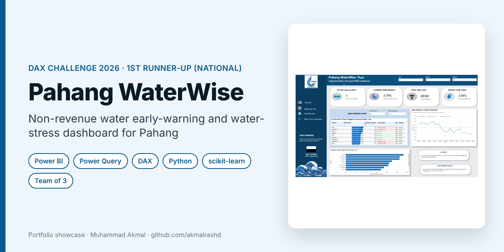
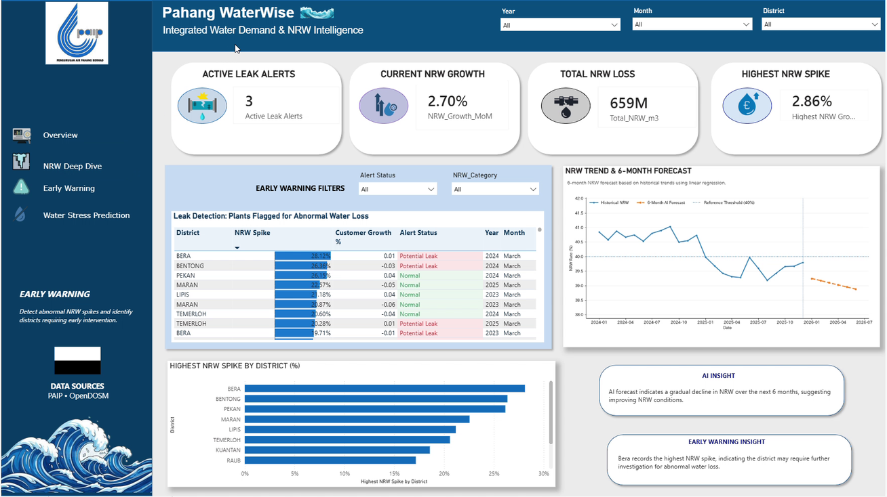
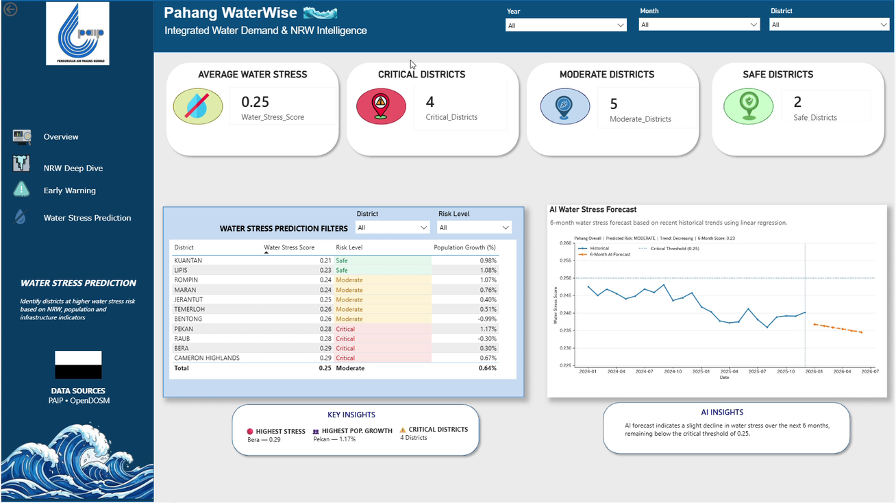
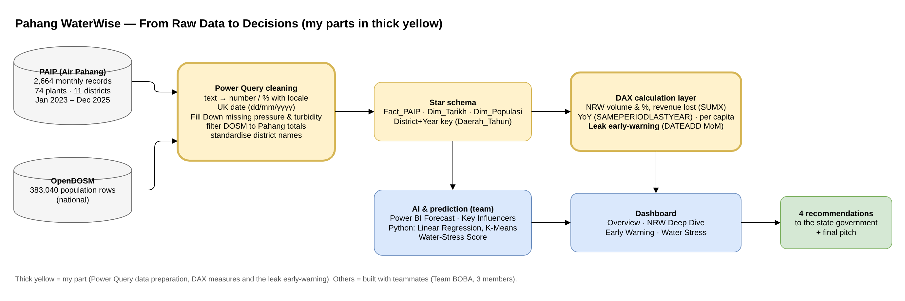
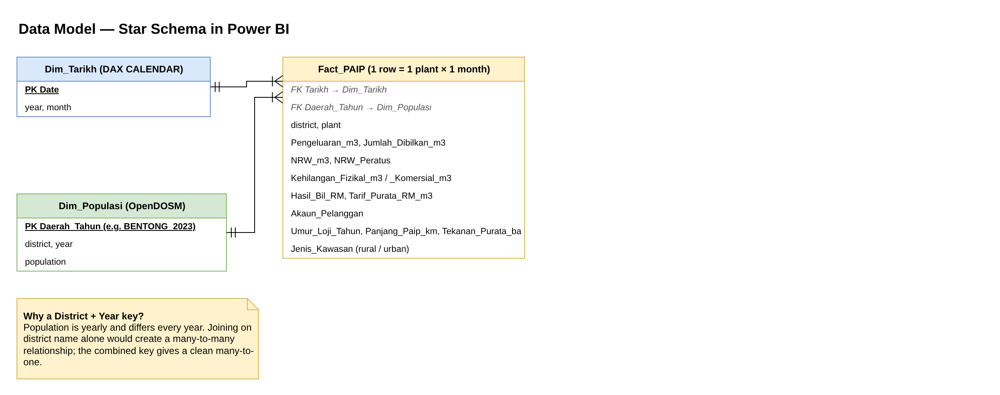
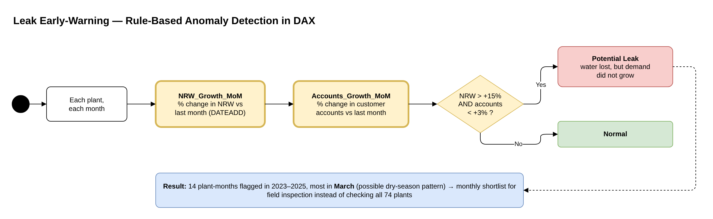

# Pahang WaterWise: Integrated Water Demand Intelligence

> **Portfolio showcase** of a team competition project. The Power BI file is not shared; a walkthrough is available on request.

**Competition:** Data AI Experience (DAX) Challenge 2026, Undergraduate category  
**Result:** 🥈 **1st Runner-Up (2nd place), national level**  
**Team:** BOBA (3 members) · **Period:** August – October 2026  
**My role:** Data preparation in Power Query and the DAX calculation layer, including the leak early-warning measures

---

## The problem

Pahang loses about **40.7%** of its treated water as non-revenue water (NRW): water that is produced but never billed, mostly through leaks. From 2023 to 2025 that is about **659.5 million m³**, or roughly **RM818 million** in lost revenue, far above the national target of around 25%. The state needs to know **where to spend first** and **what kind of fix** each district needs.

## What we built

An interactive Power BI dashboard that works as an **early-warning system**, not just a report:

| Page | What it answers |
|---|---|
| Overview | How much water and money is lost, and where |
| NRW Deep Dive | NRW by district and plant, volume versus value |
| Early Warning | Which plants show signs of a leak this month, and the NRW trend forecast |
| Water Stress Prediction | Which districts are Safe, Moderate or Critical when water loss and population growth are combined |

Dashboard pages built by Team BOBA (competition submission, 2026)

## My contribution

**1. Data preparation (Power Query)**
- Cleaned **2,664 monthly records** from Air Pahang (74 treatment plants, 11 districts, January 2023 – December 2025).
- Converted text fields such as `"286,400"` and `"61.5%"` to proper number and percentage types with the right locale, and parsed dates as UK format (dd/mm/yyyy) to avoid day/month swaps.
- Filled missing pressure and turbidity values with **Fill Down** per plant instead of deleting rows.
- Filtered the OpenDOSM population file from **383,040 national rows** to one figure per Pahang district per year, and standardised district names (for example *Cameron Highland* → *Cameron Highlands*) so the tables join correctly.

**2. DAX calculation layer**
- Measures for total NRW volume, average NRW % (averaged, not summed), revenue lost (`SUMX` of NRW × tariff), operating cost and revenue, pipe bursts, water-quality compliance, year-on-year change (`SAMEPERIODLASTYEAR`) and NRW per capita (`DIVIDE`).

**3. Leak early-warning (rule-based anomaly detection)**
- `NRW_Growth_MoM` and `Accounts_Growth_MoM` using `DATEADD` on the date table.
- `Leak_Warning` flags a plant as **Potential Leak** when NRW rises by more than **15%** in a month while customer accounts grow by less than **3%**. In other words, more water is lost but demand did not grow.
- Result: **14 plant-months** flagged, mostly in **March**. Field teams get a short monthly list instead of inspecting all 74 plants.

## System design

Editable draw.io files are in [`docs/diagrams`](docs/diagrams).

### Pipeline (my parts highlighted)

### Data model

### Leak early-warning logic

## Key findings (team)

- **Percentage is not the same as money.** Bera has the highest NRW rate (47.2%), but Kuantan, with the lowest rate (34.5%), has the **highest revenue loss** because of its scale. Budgets should use both.
- **Rural areas are 5.09× more likely** to have high NRW (Power BI Key Influencers). Districts with *fewer* reported pipe bursts can still lose a lot of water, which points to silent leaks.
- **NRW is falling by only about 0.09 percentage points a month** (Power BI Forecast and a Python linear regression), so it stays well above the 25% target without stronger action.
- **Water-Stress Score** (60% NRW + 40% population growth): Bera, Raub and Pekan are Critical because of leaks; Cameron Highlands is Critical because of fast population growth. A K-Means model (k = 3) supports the same grouping.

## Recommendations we pitched

1. Prioritise rural pipe replacement and pressure management in Bera, Raub, Pekan and Bentong.
2. Plan capacity, not just leak repair, in Cameron Highlands.
3. Use the early-warning list for monthly field inspections, planned before the dry season.
4. Use Kuantan and Lipis as internal benchmarks.

## Team

Team **BOBA**, three students at UMPSA. The forecasting, Python models, Water-Stress Score and dashboard design were done together with my teammates. Teammate's case study: [aisyhumairaz/pahang-waterwise-case-study](https://github.com/aisyhumairaz/pahang-waterwise-case-study).

## Contact

**Muhammad Akmal bin Mohd Rashid**: Software Engineering student, UMPSA.  
📧 work.akmalrashd@gmail.com · 💼 [linkedin.com/in/akmalrashd](https://www.linkedin.com/in/akmalrashd)
